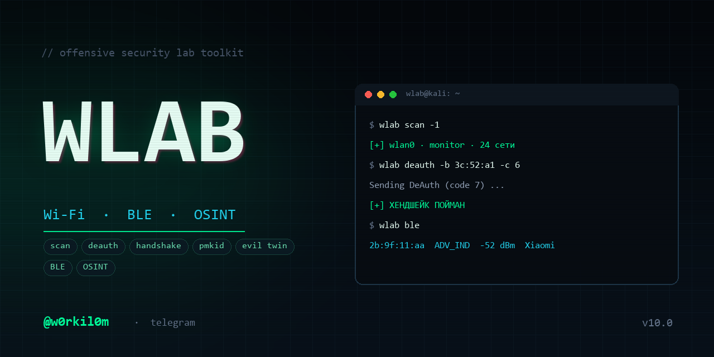

# WLAB

<p align="center">
  
</p>

<p align="center">
  <b>Лабораторный набор для Wi-Fi / BLE / OSINT</b><br>
  Один вход, один конфиг, один формат логов.
</p>

<p align="center">
  
  
  
  
</p>

<p align="center">
  автор <a href="https://t.me/w0rkil0m"><b>@w0rkil0m</b></a>
</p>

---

```bash
wlab            # меню
```

```bash
wlab scan          # что вокруг
wlab deauth -b ... # пнуть сеть / поймать хендшейк
wlab pmkid         # забрать PMKID без клиента
wlab ap --mode 2   # evil twin + портал
wlab ble           # BLE-монитор через nRF52840
wlab osint domain  # разведка по домену
```

> ⚠️ **Только для собственной лаборатории и собственного железа.** Всё остальное — статья.
> Автор не несёт ответственности за то, куда ты это направишь.

---

## Что внутри

| Команда | Что делает |
|---|---|
| `wlab scan` | live-скан эфира: сети + клиенты, топ по RSSI |
| `wlab deauth` | деаут всей сети / одного клиента / с ловлей хендшейка |
| `wlab pmkid` | PMKID-захват: не нужен клиент, не нужен деаут |
| `wlab ap` | точка доступа: обычная / evil twin / KARMA / WPA-Enterprise |
| `wlab ble` | live-монитор BLE (nRF52840): таблица + JSONL |
| `wlab pak` | разбор BLE-пакета: AD-структура, производитель, тип адреса |
| `wlab osint` | whois, dns, поддомены, WAF, заголовки, порты, CVE |
| `wlab stop` | погасить **только свои** процессы, вернуть адаптеры и сеть |
| `wlab status` | состояние адаптеров и процессов |
| `wlab anon` | рандомить MAC на обоих адаптерах |

---

## Меню

`wlab` без аргументов — интерактивное меню, как в v9:

```
1  Сканировать эфир
2  Поднять точку (обычная / evil twin / karma / wpe)
3  Деаут / снести клиента
4  Поймать хендшейк
5  PMKID
6  BLE-монитор
7  OSINT по домену
8  Статус адаптеров
9  Остановить всё
0  Выход
```

---

## Старые команды работают

Обёртки в `/usr/local/bin`, ставятся автоматически:

| v9 | v10 | что происходит |
|---|---|---|
| `wcop` | `wlab ap` | меню режимов 1-4 |
| `Wscan [канал]` | `wlab scan [-c N]` | live-скан |
| `wdeaut <канал> <bssid> [mac] [кол-во]` | `wlab deauth -c … -b …` | деаут |
| `wtaak <канал> <bssid> [mac]` | `wlab deauth … -n 0` | деаут без остановки |
| `Watak <канал> <bssid> [mac]` | `wlab deauth … -w` | деаут + хендшейк |
| `wpoisk` | `wlab scan -1` | один снимок |
| `bscan` | `wlab ble` | BLE-монитор |
| `bpak N` | `wlab pak N` | разбор пакета |
| `sscan domain` | `wlab osint domain` | OSINT |
| `wclog …` | `wlab status` + `tail` | мониторинг точки |
| `stop` | `wlab stop` | погасить всё |

То есть привычный сценарий не меняется:

```bash
sudo wcop                    # меню 1-4, поднять точку
sudo Wdeaut 6 AA:BB:CC:DD:EE:FF
sudo Watak 6 AA:BB:CC:DD:EE:FF
sudo Wscan 6
```

---

## Железо

Схема, под которую всё писалось:

```
wlan0  (Realtek)   -> точка доступа + скан       (wlab ap, wlab scan)
wlan1  (AR9271)    -> боевой: деаут, хендшейк, PMKID (wlab deauth, wlab pmkid)
nRF52840 (USB)     -> BLE-сниффер                (wlab ble)
```

Подойдёт любой адаптер с поддержкой AP и monitor. Проверка:

```bash
iw list | grep -A8 "Supported interface modes"
```

Нужны `* AP` и `* monitor`.

---

## Установка

```bash
git clone <твой-репозиторий> wlab
cd wlab
sudo bash install.sh
```

Если файлы приехали с Windows и потеряли права — `chmod +x wlab bin/* *.sh`.
В репозитории есть `.gitattributes` с `eol=lf`: без него git запишет CRLF
и bash упадёт с `bad interpreter: /usr/bin/env bash^M`.

Скрипт поставит зависимости, положит всё в `/opt/wlab`, создаст `/etc/wlab/wlab.conf`
и симлинк `/usr/local/bin/wlab`.

Опции:

```bash
sudo bash install.sh --no-deps    # пакеты уже есть
sudo bash install.sh --no-udev    # не ставить правило для nRF52840
sudo bash install.sh --clean-v9   # сначала снести остатки старой версии
sudo bash install.sh --uninstall  # снести
```

### Обновление со старой версии (v9)

Если раньше стояли `wcop`, `Wscan`, `Wdeaut`, `Watak`, `bscan`, `bpak`, `sscan`,
`stop`, `wclog` — они останутся в `/usr/local/bin` и будут мешать (особенно `stop`,
который сносит `/tmp/*.csv`). Убрать их и поставить новую версию:

```bash
sudo bash install.sh --clean-v9
```

Скрипт удалит старые команды из `/usr/local/bin`, `/usr/bin`, `~/bin`,
прибьёт зависшие `wcop`/`hostapd`/`airodump`, снесёт `/tmp/wcop_*`,
а старый `/etc/wlab.conf` сохранит как `/etc/wlab/wlab.conf.v9.bak`.

Проверить, что старое не осталось:

```bash
for c in wcop Wscan Wdeaut Watak bscan bpak sscan wclog; do
  command -v "$c" && echo "ЕЩЁ ЖИВОЙ: $c"
done
```

Ничего не вывело — чисто.

Для nRF52840 ставится udev-правило: донгл получает стабильное имя `/dev/nrf52`
вместо плавающего `/dev/ttyACM0` → `/dev/ttyACM1`. Проверь VID/PID:

```bash
lsusb | grep -i nordic
```

и поправь `share/99-wlab-nrf.rules`, если у тебя другой.

---

## Быстрый старт

```bash
sudo wlab status                  # видим ли адаптеры
sudo wlab scan                    # 30 секунд посмотреть эфир
sudo wlab scan -c 6 -1            # один снимок шестого канала
sudo wlab deauth -b AA:BB:CC:DD:EE:FF -c 6 -w
sudo wlab pmkid -d 120
sudo wlab ap --mode 1
```

---

## Команды подробно

### `wlab scan`

```bash
wlab scan                 # хоп по всем каналам
wlab scan -c 6            # только 6-й
wlab scan -1              # один снимок и выход
wlab scan -n 30           # показать 30 строк вместо 15
wlab scan --kill          # прибить мешающие процессы (остановит NetworkManager!)
```

Таблица сортируется **по реальному RSSI** (в v9 сортировка была сломана: `-k3 -nr`
по строке `" PWR: -45"` давал ноль у всех).

### `wlab deauth`

Один инструмент вместо трёх старых (`wdeaut`, `wtaak`, `watak`).

```bash
wlab deauth -b BSSID -c 6                  # 10 пакетов по всей сети
wlab deauth -b BSSID -c 6 -t MAC           # только одному клиенту
wlab deauth -b BSSID -c 6 -n 0             # бесконечно (Ctrl+C)
wlab deauth -b BSSID -c 6 -w               # + ловить хендшейк
wlab deauth -b BSSID -c 6 -w --timeout 90  # ждать хендшейк 90 с
```

Что исправлено:
- канал ставится через `iw dev <iface> set channel` (в v9 было `iw <iface>`, что не работает);
- broadcast-деаут — это отсутствие `-c`, а не `FF:FF:FF:FF:FF:FF`;
- хендшейк ищется регуляркой `[1-9][0-9]* handshake` (в v9 `"1 handshake"` ломался на двух);
- airodump убивается по своему PID, ждём его, а не `kill $!` от sudo.

### `wlab pmkid`

```bash
wlab pmkid                 # 60 секунд слушать
wlab pmkid -d 300          # 5 минут
wlab pmkid -b BSSID        # отфильтровать по точке
```

Быстрее и надёжнее хендшейка: клиент не нужен, деаут не нужен.
Результат: `/var/log/wlab/caps/pmkid_*.hc22000`, дальше
`hashcat -m 22000`.

### `wlab ap`

```bash
wlab ap                    # меню
wlab ap --mode 1           # обычная точка
wlab ap --mode 2           # evil twin: весь DNS на нас + портал
wlab ap --mode 3           # KARMA (нужен hostapd-mana)
wlab ap --mode 4           # WPA-Enterprise (нужен hostapd-wpe)
```

Флаги: `--ssid`, `--channel`, `--pass`, `--no-nat`, `--no-anon`, `--no-portal`.

Что реально изменилось:
- **режимы 3 и 4 больше не врут.** Если `hostapd-mana`/`hostapd-wpe` нет — скрипт
  падает и говорит об этом. В v9 он молча запускал обычный hostapd, а меню
  показывало «KARMA».
- для MANA пишется настоящий конфиг с `enable_karma=1`;
- для WPE — `ieee8021x=1`, `eap_server=1`, `eap_user_file`, `wpe_logfile`;
- ошибки hostapd/dnsmasq **пишутся в файл**, а не в `/dev/null`;
- после старта проверяется, что интерфейс реально в `type AP` (10 попыток);
- NAT через отдельные iptables-цепочки `WLAB_NAT` / `WLAB_FWD`, убираются точно;
- портал отдаётся локально на `http://<AP_IP>/`, iptables для этого не нужен;
- `ip_forward` восстанавливается до исходного значения.

Портал: положи свою страницу в `/opt/wlab/share/portal/index.html`.
Дефолтная — заглушка, которая просто доказывает, что редирект работает.

### `wlab ble` / `wlab pak`

```bash
wlab ble                      # всё
wlab ble AA:BB:CC:DD:EE:FF    # только это устройство
wlab ble ADV_IND              # только реклама
wlab ble CONNECT              # только подключения
wlab ble -d 60                # 60 секунд и стоп

wlab pak 1234                 # разбор пакета 1234
wlab pak --list               # последние 20 пакетов
```

`wlab ble` сам определяет, какие поля поддерживает твоя версия tshark
(`tshark -G fields`), поэтому не падает на незнакомых полях.

`wlab pak` показывает:
- основание пакета: PDU, время, RSSI;
- тип адреса (public / random static / RPA);
- производителя по OUI (из `wireshark/manuf` или `nmap-mac-prefixes`);
- полную AD-структуру: Flags, UUID, TX Power, Service Data, Manufacturer Specific
  с расшифровкой company ID.

### `wlab osint`

```bash
wlab osint example.com
wlab osint example.com --full          # все 65535 портов
wlab osint example.com --ports 22,80,443
wlab osint example.com --no-nmap
wlab osint example.com --no-nikto
```

Отчёт в markdown: `/var/log/wlab/osint/<домен>_<дата>.md`.
В конце владелец файлов меняется на `$SUDO_USER` (в v9 отчёт уезжал в `/root`
и его никто не находил).

Nikto вызывается с `-Tuning 123bc` — **без** `x`. В v9 было `123bcx`,
а `x` в Nikto означает «всё, кроме перечисленного», то есть ровно наоборот.

### `wlab stop` / `status` / `anon`

```bash
wlab stop           # погасить всё, вернуть адаптеры, поднять NetworkManager
wlab stop --purge   # + снести логи сессии
wlab status         # адаптеры, режимы, живые процессы
wlab anon           # рандомный MAC на wlan0 и wlan1
```

`stop` убивает **только свои** процессы: PID-файлы из `/run/wlab`,
`hostapd`/`dnsmasq` строго с нашими конфигами, свои iptables-цепочки.
Никаких `rm /tmp/*.csv` (в v9 это сносило чужие файлы и не убирало свои).

---

## Конфиг

`/etc/wlab/wlab.conf`, права `600` (может содержать пароль точки).

```bash
IFACE_MON="wlan1"
IFACE_AP="wlan0"
IFACE_SCAN="wlan0"     # скан на том же адаптере, что точка
IFACE_BLE="/dev/nrf52"
IFACE_UP=""            # пусто = определить по default route
AP_SSID="FreeWiFi"
AP_PASS=""             # пусто = открытая
AP_IP="192.168.50.1"
DHCP_RANGE="192.168.50.10,192.168.50.100"
ENABLE_NAT="1"
ANON_MAC="1"
LOG_JSONL="1"
```

После правки ничего перезапускать не надо — скрипты читают конфиг на старте.

---

## Анонимность

Что уже сделано:

- `ANON_MAC=1` — рандомный MAC (локально-администрируемый, `macchanger`) перед работой;
  `wlab anon` — вручную;
- evil twin работает с `no-resolv` и `address=/#/` — **ни один DNS-запрос не уходит
  наверх**, всё остаётся в лаборатории;
- udev-правило убирает плавающий ttyACM;
- никакой телеметрии, никаких внешних вызовов, кроме `wlab osint` (он по определению
  ходит в интернет — это его работа);
- логи локальные, `wlab stop --purge` стирает сессию целиком.

Что важно помнить:

- **не запускай `wlab scan --kill` без нужды** — `airmon-ng check kill` убивает
  NetworkManager;
- MAC рандомится, но hostname/SSID-списки всё равно тебя выдают — для реальной
  анонимности нужен отдельный адаптер и отдельная машина;
- режим 1 (обычная AP с NAT) по определению прокидывает трафик клиентов наружу.

---

## Логи

```
/var/log/wlab/
├── ap.jsonl          # точка: старт, клиенты, DNS-запросы
├── scan.jsonl        # сканы
├── deauth.jsonl      # деауты, найденные хендшейки
├── pmkid.jsonl       # PMKID
├── ble.jsonl         # BLE-пакеты (текущая сессия)
├── ble_YYYY....jsonl # прошлые сессии
├── ap/               # dns.log, hostapd.log, dnsmasq.log, wpe.log
├── caps/             # .cap и .hc22000
└── osint/            # markdown-отчёты
```

Формат — одна строка на событие:

```json
{"ts":"2026-11-10T07:20:00Z","tool":"ap","evt":"client","ip":"192.168.50.10","mac":"aa:bb:...","host":"phone"}
```

Грепается как угодно, парсится `jq`:

```bash
jq -r 'select(.evt=="dns") | .name' /var/log/wlab/ap.jsonl | sort | uniq -c | sort -rn
```

---

## Четыре классических бага и как они закрыты

| Баг | Было | Стало |
|---|---|---|
| root-файлы от `sudo` | логи под root, юзер не читает | `/var/log/wlab` 755, отчёты `chown $SUDO_USER` |
| `/dev/ttyACM0` → `ttyACM1` | хардкод в конфиге | udev-симлинк `/dev/nrf52` |
| ANSI-цвета ломают таблицы | цвета в `printf`/`awk` | цвета только в tty, в файл — через `sed` чистка |
| `while true` + чтение файла | жрёт CPU, рвёт данные | `tail`-подобное чтение по inode + `sleep`, JSONL |

---

## Если не работает

| Симптом | Причина / решение |
|---|---|
| `interface type monitor` не ставится | `iw list` не показывает `* monitor`; драйвер. Проверь `dmesg` |
| `wlab scan` пустой экран | интерфейс занят: `wlab stop`, потом `wlab scan --kill` |
| деаут не отваливает клиента | канал не тот: `-c`; либо WPA3/PMF — деаут игнорируется |
| хендшейк не ловится | клиент не переподключился; попробуй `-n 0` и жди дольше |
| `wlab ap` падает «hostapd не поднял AP» | смотри `/var/log/wlab/ap/hostapd.log`; канал 12-13 при `RU`; драйвер без AP |
| у клиентов нет интернета | нет аплинка или `ENABLE_NAT=0`; `ip route` |
| `tshark` не видит nRF | нет плагина nRF Sniffer; `tshark -D \| grep nRF` |
| `wlab osint` пустой whois | `whois` не установлен или домен без WHOIS |
| после сессии нет Wi-Fi | `wlab stop` — он поднимает NetworkManager |

---

## Структура

```
wlab/
├── wlab                 # диспетчер
├── install.sh
├── uninstall.sh
├── README.md
├── CHANGELOG.md
├── LICENSE
├── etc/wlab.conf
├── lib/
│   ├── wlab_lib.sh      # цвета, root, iface, JSONL, OUI
│   └── packet_show.py   # разбор BLE-пакетов
├── bin/
│   ├── wlab_ap.py
│   ├── wlab-scan
│   ├── wlab-deauth
│   ├── wlab-pmkid
│   ├── wlab-ble
│   ├── wlab-pak
│   ├── wlab-osint
│   └── wlab-stop
├── compat/              # старые имена: wcop, Wdeaut, Watak, bscan ...
├── assets/              # banner.png, logo.png
└── share/
    ├── 99-wlab-nrf.rules
    └── portal/index.html
```

---

## Автор

**@w0rkil0m** — [t.me/w0rkil0m](https://t.me/w0rkil0m)

Проект собран под личную лабораторию: два USB-адаптера (Realtek + AR9271),
донгл nRF52840, Kali в VirtualBox. Всё проверено на живом железе,
все косяки из v9 найдены и починены.

Вопросы, баги, идеи — в телегу.

---

## Лицензия

MIT. Делай что хочешь, но отвечаешь за это сам.
